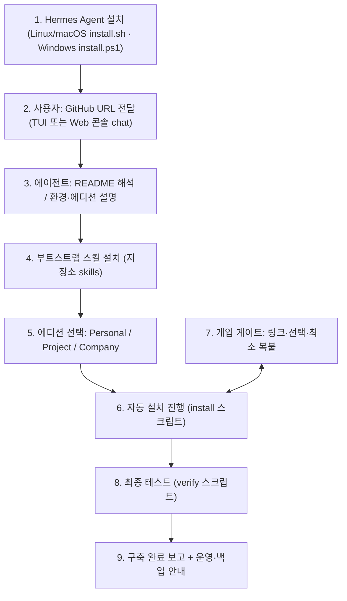
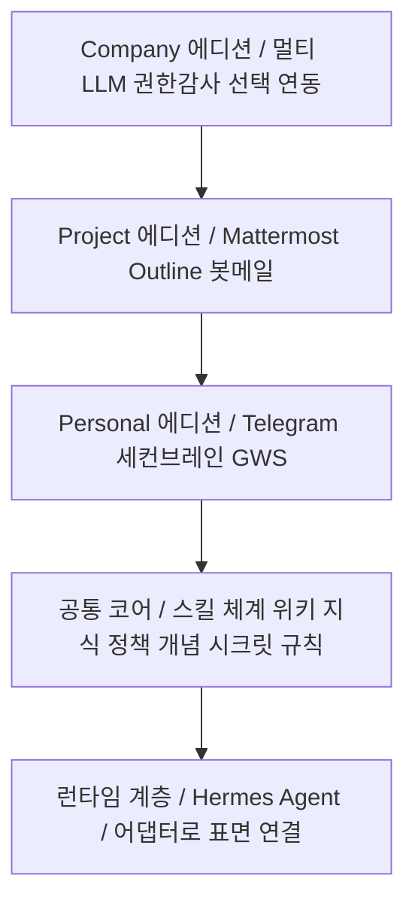

# Open Agent OS 아키텍처 및 구현 설계서 — 3-에디션 · "URL 하나로 구축"

> **대상**: openit-ai/open-agent-os (공개 저장소 · 릴리스 v2.x)
> **관계**: 본 문서가 OAOS 제품 설계의 **단일 최종본**이다. 구 플랫폼(비공개 `open-agent-os-platform`, 아키텍처 v1.7.5·제품 0.1.10)은 Company 에디션 흡수 원천으로만 참조한다. 버전별 사본 파일을 두지 않고 변경 이력은 git과 아래 개정 이력으로 관리한다.
> **목표**: Hermes Agent 설치 후 **저장소 URL 하나를 알려주면** README 설명부터 대부분의 설치, 최종 테스트까지 에이전트가 자동 진행 — 사용자는 **링크 확인·선택·최소 복사/붙여넣기**만 한다.
> **입력**: 3-에디션 설계 요구(2026-09-25) · 구축 실측 가이드 2종(개인용·프로젝트용, 2026-09-22)
> **버전**: v2.1 (2026-11-16) — 현행 최종본 · 개정 이력은 부록 D
> **수치 원칙**: 금액·제품명·경로·구성 값은 공식 출처로 검증해 기재(§0-1, 부록 C)

---

## 0. 한 장 요약

| 항목 | 내용 |
|---|---|
| 제품 | **Open Agent OS (OAOS)** — 3-에디션: **Personal / Project / Company** |
| 핵심 경험 | Hermes Agent 설치(공식) → **GitHub URL 1개 전달** → README 해석·환경 설명 → 부트스트랩 스킬로 설치 자동 진행 → 최종 테스트까지 완료 |
| 사용자 개입 | 게이트당 **링크 + 선택 + 최소 복붙** (선택 포함 Personal 5·Project 10·Company 14개소) |
| 적층 구조 | Personal ⊂ Project ⊂ Company — Company는 **5~50인 중소기업용 확장 에디션**(멀티 LLM 라우팅·권한·감사 + 선택형 연동) |
| 기준 실측 | Personal: 기존 Ubuntu 미니PC(N100급·16GB) 사례·월 $10 API(OpenCode Go 정액, 2026-09-25 확인); macOS·Windows 실기기 검증 대기 / Project: VPS 1대(4 vCPU·16GB·200GB급) |
| 비용 원칙 | 본 솔루션으로 **새로 드는 비용은 서버·LLM 정액 등 솔루션 자체 항목뿐** — Google Workspace·Microsoft 365·Slack·Notion 등은 **기업이 기존에 사용 중인 서비스에 연동**(추가 비용 없음) |
| 지원 환경 | Personal 설치 스크립트: Ubuntu LTS·Apple Silicon macOS·Windows 11 Git Bash; Project·Company: Ubuntu LTS 서버. 사전 요건: Hermes Agent 공식 설치 · 표면: TUI/Web 콘솔/메신저 |
| 배포 | GitHub(openit-ai/open-agent-os) + Hermes 스킬(URL 설치) |
| 최종 산출 | 동일 절차로 **누구나** 자기 환경(Personal~Company)을 구축·운영 |

### 0-1. 표기·검증 원칙 (문서 공통)

1. **제품·서비스명**: 공식 표기 사용 — Google Workspace, Microsoft 365, Slack, Notion, OpenCode Go, Telegram, Mattermost, Outline, Hermes Agent 등.
2. **금액**: 출처·확인일 병기 — 예: "월 $10(opencode.ai/go, 2026-09-25 확인)". 프로모션·지역 변동 항목은 "구매 시점 확인"을 명시.
3. **비용 서술 구분**: "본 솔루션으로 새로 발생하는 비용"과 "기업이 기존에 지출 중인 서비스(연동 대상)"를 구분한다 — 기존 지출 서비스는 솔루션 비용으로 계상하지 않는다.
4. **경로**: 홈(`~`)·저장소 상대경로 기준. 실환경 절대경로·계정명은 문서에 싣지 않는다.
5. **구성 값**(포트·사양·버전): 기본값과 변경 가능성을 함께 표기 — 예: "기본 포트 8065(변경 가능)".
6. **미확인 정보**: "미검증/확인 필요"로 명시 — 추정값을 확정 표현으로 쓰지 않는다.
7. **출처 등급**: 공식 문서·공식 사이트를 확정 근거로, 비공식 자료는 참고용으로 구분 표기.
8. **약어·기호**: 처음 등장할 때 뜻을 함께 밝힌다 — 예: OAOS(Open Agent OS), E(실설치 대상 환경). 문서 안에서 한 번 정의한 약어는 이후 설명 없이 사용한다.
9. **지칭**: 대상은 구체 명칭으로 쓴다 — "해당 서버"·"① 환경" 대신 "Project 호스트"·"Company 검증 인스턴스"처럼 문서에서 정의한 명칭을 반복해 쓴다.

---

## 1. 배경과 진단

- **기존 OAOS의 한계**: Hermes 권한을 줄이고 제어하는 기업용 래퍼로 출발 → 런타임(Hermes Agent)의 가치·기능을 쓰지 못하는 완성도 낮은 제품이 되어가는 중.
- **재설계 방향**: Hermes 네이티브 실행을 주체로 승격하고, 기존 자산(지식·위키·정책·세션·감사)은 상위 에디션(Company)으로 흡수한다.
- **목표 사용자**: 서버 운영 전문성은 없지만 컴퓨터를 다루는 개인·소규모 팀·중소기업(5~50인). **전문 절차는 에이전트가 대신 수행**하고, 사람은 선택과 승인만 한다.
- **핵심 성공 기준**: "설치를 가르치는 문서"가 아니라, **에이전트가 읽고 실행하는 저장소**. README는 사람과 에이전트가 함께 읽는 진입점이다.

---

## 2. 핵심 UX — "URL 하나로 구축"

### 2.1 사용자 여정



- 2단계 URL은 사용자가 채팅에 붙여넣는 한 줄이다: 예) `openit-ai/open-agent-os 이거 설치해줘`.
- 에이전트는 README → 부트스트랩 스킬 → 설치·검증 순으로 스스로 진행하고, **개입이 필요한 순간에만** 사용자에게 링크와 함께 요청한다.
- 표면(TUI/Web 콘솔/메신저)에 무관하게 동일하게 동작한다 — 스킬·스크립트가 로직을 가지므로.

### 2.2 부트스트랩 구성요소 (저장소 자산)

**지원 환경(설계 기준)**: Personal은 Ubuntu LTS·Apple Silicon macOS·Windows 11 Git Bash 설치/검증 스크립트가 구현됐고, Linux 스모크 및 타 OS 모의 검증을 완료했다. 3 OS CI 매트릭스(ubuntu/macOS/Windows)를 통과했고(2026-09-27), 실기기 검증은 대기 중이다. Project·Company는 Ubuntu LTS 서버 경로다. 사전 요건 — Hermes Agent 공식 설치 · 표면 — TUI/Web 콘솔/메신저.

| 자산 | 역할 | 읽는 주체 |
|---|---|---|
| `README.md` / `README.ko.md` | 프로젝트 소개(3-에디션·비용·아키텍처) + **에이전트용 부트스트랩 블록** | 사람 + 에이전트 |
| `START-HERE.md` (또는 README 내 블록) | 에이전트가 따라야 할 정밀 절차(스킬 설치 → 선택 → 설치 → 검증) | 에이전트 |
| `skills/oaos-bootstrap/SKILL.md` | 오케스트레이터: 환경 점검→에디션 선택→install 호출→게이트 처리→verify→리포트 | 에이전트 |
| `editions/<e>/install.sh` | 에디션별 설치(멱등·체크포인트·로그) | 에이전트 실행 |
| `bootstrap/verify/<e>-verify.sh` | 최종 테스트(서비스·응답·파일·위키·크론·서비스 등록 확인); 실제 재부팅/로그인 생존은 별도 실기기 증거 | 에이전트 실행 |
| `bootstrap/lib/*` | 공통: 환경 점검·시크릿 처리(.env 600)·체크포인트·로그 | 공용 |
| `editions/<e>/README.md` | 에디션별 설치·운영 문서(게이트·검증·원복) | 사람 + 에이전트 |
| `docs/*.md` | 버전 없는 최종본 설계 문서 — `architecture`·`personal-cross-platform`·`computer-use-credential-typing`·`company-plan`·`company-design`·`cookbook`·`faq` | 사람 + 에이전트 |

**스킬 설치 문법(2026-09-25 실측 확인)**: `hermes skills install <identifier | SKILL.md URL>` — Hermes CLI 도움말에서 "direct HTTP(S) URL to a SKILL.md file" 형식 지원을 확인(Hermes Agent v0.21.5 기준). README에는 `https://raw.githubusercontent.com/openit-ai/open-agent-os/main/skills/oaos-bootstrap/SKILL.md` 형식을 싣고, 저장소 푸시 후 P0에서 실설치로 최종 확인한다.

### 2.3 개입 게이트 설계 규칙 (사용자 부담 최소화)

1. 모든 게이트는 **① 클릭 가능한 링크 ② 왜 필요한지 1줄 ③ 저장할 변수 이름(정확한 키)** 순서로 안내한다.
2. 비밀값은 사용자가 **자기 터미널의 숨김 입력**(`bash bootstrap/bin/oaos-secret-set KEY`)으로 넣는다. 채팅에 붙여넣지 않게 안내하고, 명령행 인자(`hermes config set KEY <값>` 등)로 넘기는 경로는 금지한다. 비밀이 아닌 값(숫자 ID·도메인 등)은 채팅으로 받아도 된다.
3. 저장 직후 단계 재실행에서 **즉시 검증**한다(게이트별 검증 방법은 §2.4). 실패하면 값은 저장된 채로 단계를 BLOCKED로 두고 원인·재입력 링크를 다시 안내한다.
4. 값은 Hermes `.env`에만 저장한다(예외: Project 서비스 내부 파일 `~/oaos/stack/.env`·`/etc/oaos/outline.env`(root 600)·Mattermost `config.json`(600) — 게이트 값이 아닌 서비스 내부 값만, verify가 권한 확인. Outline IdP 값은 Hermes `.env`에 `OUTLINE_<KEY>`로 저장) — 원자적 쓰기, 소유자 전용(Linux·macOS 600+소유자 확인, Windows NTFS ACL), 단일 도우미(`bootstrap/lib/secret.sh`)만 쓴다. 스킬·스크립트는 값을 재출력하지 않으며 로그·문서·위키·상태 파일에 남기지 않는다.
5. 게이트는 "선택"과 "제공(필수)" 두 종류만 존재한다. 그 외(설정 파일 편집·명령 타이핑)는 전부 에이전트 몫이다. 설치기를 `--yes`로 실행하는 것은 사용자가 해당 선택 게이트를 승인한 뒤에만 한다.
6. 게이트가 발생하기 전까지는 **무인 진행**을 원칙으로 하고, 진행 상황은 시작·게이트·검증·완료 시점에만 보고한다.

### 2.4 개입 지점 (에디션별)

**Personal — 필수 3 + 선택 1 (G4 보류)**

| # | 게이트 | 사용자 액션(최소) | 저장 키 | 즉시 검증 |
|---|---|---|---|---|
| 선택 | Hermes 설치 승인 | 설치 스크립트 SHA-256 확인 후 승인 | — | Windows `install.ps1`은 `OAOS_HERMES_INSTALLER_SHA256` 지정 시에만 실행 |
| G1 | LLM | OpenCode Go(대안: OpenRouter·Vercel AI Gateway) 키 입력 또는 Nous Portal OAuth 로그인 | `OPENCODE_GO_API_KEY` · `OPENROUTER_API_KEY` · `AI_GATEWAY_API_KEY` | 30초 제한 모델 응답 1회(키 존재만으로는 통과 아님, OAuth도 응답으로 판정) |
| G2 | Telegram 봇 | BotFather `/newbot` → 토큰 입력 | `TELEGRAM_BOT_TOKEN` | `getMe`(토큰은 curl 표준입력 설정으로 전달) |
| G3 | Telegram 사용자 ID | @userinfobot → 숫자 ID | `TELEGRAM_ALLOWED_USERS` | 숫자 ID 목록 형식 |
| G4 | (보류) 대용량 파일·Local Bot API | — | — | 구현 보류 — 필요 시 별도 설계 |
| G5 | (선택·수동) 이메일 | Gmail 앱 비밀번호 | 도우미로 저장 | 자동 검증 없음(수동 단계) |

**Project — 필수 8 (G0–G3·G6–G9) · G4/G5 미제공**

| # | 게이트 | 사용자 액션(최소) | 저장 키 | 즉시 검증 |
|---|---|---|---|---|
| G0 | 서버 준비 | VPS 구매 → **그 VPS에 Hermes 설치** → 에이전트에 URL 전달 | — | 사양 4 vCPU·16 GB·200 GB 미만 WARN, 2 vCPU·8 GB·60 GB 미만 BLOCKED(`OAOS_ALLOW_SMALL_HOST=1` 예외) · SSH 키 로그인 여부 · 포트 80/443/3000/5432/6379/8065 선점 확인 · UFW(22·현재 SSH·80·443 허용 후 활성, `OAOS_UFW_ENABLE=0` 제외) |
| G1–G3 | LLM·Telegram | Personal과 동일 | Personal과 동일 | Personal과 동일 |
| G6 | 도메인 DNS(필수) | A 레코드 3개(chat/note/portal) 등록 | 도메인 값 | 전파 자동 폴링(기본 최대 600초) · ACME 이메일 기본값 = G9 주소 |
| G7 | Mattermost | 사람 관리자 가입 → **봇 계정** 토큰 + 허용 사용자 ID | `MATTERMOST_TOKEN` · `MATTERMOST_ALLOWED_USERS` | 토큰이 봇(`is_bot`)이고 `system_admin` 아님 · 허용 ID 26자 형식·실존 확인 |
| G8 | Outline | 사람 관리자가 먼저 가입 → **AI 에이전트 계정**(G9 봇 메일함, 멤버·편집자) 초대 → 그 계정의 API 토큰 | `OUTLINE_API_TOKEN` (+ `OUTLINE_URL` 자동) | `auth.info` 이메일 = G9 주소 · 관리자 아님 |
| G9 | 봇 전용 메일 | 전용 Gmail + 앱 비밀번호 | `OAOS_MAIL_ADDRESS` 등(IMAP/SMTP 호스트는 Gmail 기본값) | IMAP·SMTP 로그인 둘 다(실패 = FAIL) |

- 봇·에이전트 계정 원칙: 팀 서비스에 쓰는 토큰은 사람 관리자 계정이 아닌 **비관리자 봇/에이전트 계정** 것만 받는다(정보보안 분리·최소 권한·감사 귀속).

**Company — Project 게이트 + 확장 게이트(제공 1 + 선택 3)**

| # | 구분 | 게이트 | 사용자 액션(최소) | 에이전트 제공 |
|---|---|---|---|---|
| G10 | 제공(필수) | 관리자 콘솔 초기 설정 | 관리자 계정·구성원 매핑 입력(브라우저) | 콘솔 안내·기존 OAOS 자산 연결 |
| G11 | 선택 | 생산성 스위트 연동 | Google Workspace **또는** Microsoft 365 — OAuth 클라이언트 등록·복붙 | 콘솔 링크·리다이렉트 URI 제공 |
| G12 | 선택 | 협업 도구 연동 | Slack·Notion 사용 조직: 앱 생성·토큰 복붙 | 매니페스트·콘솔 링크·권한 안내 |
| G13 | 선택 | 멀티 LLM 확장 | 프리미엄 모델(Codex·Claude 등)·추가 모델 API 도입 시 키 복붙 | 요금 비교·라우팅 자동 구성; 사용량 과금 경로는 승인 필요 |

### 2.5 자동화 범위 (Personal 기준)

| 구간 | 자동 진행 | 사용자 개입 |
|---|---|---|
| OS 준비 | Ubuntu: apt·swapfile(여유 10 GiB·10% 이상일 때만)·시간대·절전 마스킹/logind 드롭인(변경한 호스트 설정으로 보고); macOS: 도구 확인·OS 관리 swap·시간대/절전 수동 판정; Windows Git Bash: 도구 확인·pagefile 조회·시간대/전원 수동 판정 | 불확실한 OS 설정은 수동 확인 |
| Hermes 설정 | `.env`는 비밀값 도우미로만 기록 · 승인 정책 `approvals.cron_mode`·`single_query_mode`·`unattended_mode`를 미설정 시 deny로 설정(명시적 approve면 gateway 단계 차단) · `gateway install`(Ubuntu systemd/linger, macOS launchd, Windows ONLOGON 태스크/Startup 폴백) — 모델 선택은 Hermes 설정 마법사 | G1 |
| Telegram | `getMe`·숫자 허용 목록 확인 → gateway는 telegram 단계 완료 후에만 기동(변경 시 재시작) | G2·G3 |
| 위키(세컨드 브레인) | git repo·색인 시드·비밀값 차단 pre-commit 훅 (bare 중계·7축 스키마는 미구현) | — |
| 하네스 | SOUL/USER/MEMORY 초안 + 설치기가 아는 호스트 정보를 MEMORY에 기입 → 대화로 확인·보정 | 문구 확인(대화) |
| 자동화 | 일일 백업 = Hermes cron(에이전트 비호출) · gateway watchdog = OS 타이머(systemd user timer / launchd — Hermes cron은 gateway 안에서 돌아 gateway 정지 시 동작 불가) · Windows는 watchdog 없음 | — |
| 최종 테스트 | `personal-verify.sh` 19항목 · 종료코드 0 PASS / 2 MANUAL 대기 / 1 FAIL · 사람 확인은 `--confirm reboot,chat,allowlist`로 기록 | 재부팅·대화·허용 목록 확인 |

- 원칙: **자동이 기본값, 개입은 예외**. 개입 지점 수를 늘리는 설계 변경은 이 문서에 반영해 승인받는다.
- Project·Company도 같은 구조(도우미·상태·종료코드)를 쓴다.

### 2.6 실패·재개 원칙

- **멱등**: install은 재실행 안전 — 완료된 단계는 건너뛰되 **verify는 항상 다시 실행**한다. `--recheck`는 완료 단계도 재검사, `--reverify`는 검증만 실행.
- **실패 시 닫힘**: 각 단계는 errexit가 켜진 서브셸에서 실행해 중간 실패를 무시하지 않는다.
- **재개 가능**: `~/.oaos-install/state.json`에 에디션별 단계(`editions.<edition>.stages`)를 기록한다 — 같은 호스트의 다른 에디션 기록이 단계를 건너뛰게 하지 않는다. 기존 평면 `stages`는 마지막 기록 에디션의 보기로만 읽는다.
- **비파괴 기본**: 기존 데이터·설정은 보존, 파괴적 작업은 명시 승인 후만.
- **세 가지 결과만**: 전 항목 PASS = `verified`(종료 0) · FAIL 없음+MANUAL 대기 = `applied`(종료 2, "대기"로 보고하며 완료로 표기 금지) · FAIL = `failed`(종료 1). PARTIAL 포장 금지.

---

## 3. 설계 원칙

| 원칙 | 내용 | 근거 |
|---|---|---|
| ① 경제성 | 보유 하드웨어 + 무료 경로 우선 + 저가 정액 API(월 $10 — OpenCode Go, 2026-09-25 확인). 기존 사용 서비스(Workspace·365·Slack·Notion 등)는 연동만 — 신규 지출로 계상하지 않음 | 실측(2026-09-22) |
| ② 보안성 | 자체 호스팅·데이터 주권 · 시크릿 `.env`(600) 단일 보관 · 최소 권한 | OAOS 경험(owner 격리) |
| ③ 확장성 | 스킬·MCP·에디션 확장 경로(Personal→Project→Company) | 3-에디션 구조 |
| ④ 무개입 지향 | 자동 최대화, 개입은 링크·선택·복붙 최소 | 설계 요구(핵심) |
| ⑤ 검증 우선 | 최종 테스트 자동(verify)이 완료 조건 | 완료 판정 원칙 |
| ⑥ 멱등·재개 | 중단·재시도가 정상 경로 | 운영 현실 |
| ⑦ 런타임 비종속 | 제품·에디션 명칭에 특정 런타임을 고정하지 않음(향후 교체 대비) | 설계 요구 |

---

## 4. 에디션 정의

### 4.1 Personal — 개인 1인 · 미니PC

- **구성**: Hermes Agent + Telegram + md 세컨드 브레인(git 위키 + Obsidian) + 개인 추천 스킬 + 개인 메일(Himalaya·Gmail 앱 비밀번호)
- **자원**: 기존 Ubuntu 미니PC 사례는 N100급 4코어 / 16GB / 256~512GB SSD — 24시간 상시. macOS·Windows의 하드웨어/절전·로그인 조건은 실기기 확인 필요
- **비용**: 월 $10(LLM 정액 — OpenCode Go, 2026-09-25 확인) + 전력. 소프트웨어 전부 무료/오픈소스
- **기존 Ubuntu 기준 실측**(2026-09-22): 무중단 17일+, load 0.44. macOS·Windows 동일 동작의 근거는 아님
- **차별점**: 폰(Telegram)에서 시작·종료, 대화가 곧 위키 자산, 자택 데이터 보관

### 4.2 Project — 소규모 팀(2~6인) · 서버 1대

- **구성**: Hermes Agent + **Mattermost**(팀 허브) + **Outline**(프로젝트 위키) + PostgreSQL/Redis + Telegram(개인 창구) + nginx/TLS(3도메인) — **Docker 미사용, 네이티브 systemd**
- **바인딩**: PostgreSQL(`listen_addresses=localhost`)·Redis·Mattermost·Outline 모두 127.0.0.1, 외부는 nginx 443만
- **백업·복구**: 두 DB `pg_dump` + 서비스 데이터·설정 + Hermes/위키 → 700/600, 최근 7개 보관 · `restore.sh --dry-run|--yes` · verify가 실제 백업 작업과 복구 dry-run 실행
- **Outline 연동 범위**: `OUTLINE_URL`·`OUTLINE_API_TOKEN`만 저장 — 전용 Outline 스킬/MCP는 아직 미제공(후속)
- **자원**: 4 vCPU / 16GB / 200GB급 VPS 1대(예: Hostinger KVM 4). 요금은 프로모션 변동 — 공식 KR 페이지 기준 KVM 전 플랜 월 ₩10,059~₩40,259(2026-09-25 확인, 구매 시점 확인)
- **메일 분리 원칙**: 외부 소통은 **봇 전용 Gmail + Himalaya** — 개인 Google 계정 연동 시 정보보안 문제를 구조적으로 차단
- **기준 실측**(2026-09-22): 5개 서비스 동시 구동, 메모리 여유 12 GiB(4 vCPU/15 GiB)
- **차별점**: 팀 협업(웹·모바일·권한) + git 위키 정본 하이브리드

### 4.3 Company — 5~50인 중소기업

- **기반**: Project 에디션 구성 + 중소기업 요구 기능 확장
- **핵심 확장**:
  - **멀티 LLM/API 라우팅**: 기본 저가 모델 + 프리미엄 모델(Codex·Claude 등)·추가 모델 API를 작업별 라우팅(도입 선택). 사용량 과금 경로는 **요청 관리자와 다른 관리자가 결정한 C07 JIT 승인**이 있어야 등록되며 승인 id·결정자가 기록된다
  - **개인별 독립 AI 비서**: 구성원별 개인 계정 연동 시 권한 제어 — `owner == credential == provider == output` 격리
  - **거버넌스**: 정책 엔진 + JIT 승인 + 감사 + Secret Vault + ACL 지식 인덱스 + 관리 콘솔 — 현재는 **DB 수준(RLS·트리거·권한)에서 강제**하며, 비서 실행 경로에서 이를 호출하는 런타임 연결(서비스 API)은 후속 개발
- **선택형 연동(옵션)** — 조직이 **이미 도입·사용 중인** 서비스에 연동한다(본 솔루션 도입으로 인한 추가 구독 비용 없음):
  - 생산성 스위트: **Google Workspace 또는 Microsoft 365** — 조직 표준에 맞춰 선택 연동(메일·문서·일정)
  - 협업·지식 도구: **Slack**·**Notion** 등 — 이미 사용 중인 조직에 한해 어댑터 활성화
- **기존 OAOS 자산 흡수**: 개인별 비서, 정책·승인, 권한 인식 검색, 개인 위키, 관리 콘솔 — 공개·이식 적합성을 확인해 필요한 코드·테스트만 Company 레이어로 선별 흡수
- **대상**: 5~50인 중소기업 — 요구에 맞춘 변경 수용 모델

### 4.4 비교와 확장 경로


| 항목 | Personal | Project | Company |
|---|---|---|---|
| 대화 창구 | Telegram | Mattermost + Telegram | + Slack(기존 사용 시 옵션) |
| 지식 | git 위키(Obsidian) | Outline + git 위키 | + Notion(기존 사용 시 옵션)·ACL 인덱스 |
| 메일 | 개인/전용 Himalaya | 봇 전용 메일 | 기존 스위트 연동(Google Workspace 또는 Microsoft 365) |
| 모델 | 저가 정액 1종 | 저가 정액 중심 | 멀티 LLM 라우팅(프리미엄 포함) |
| 권한·감사 | 최소 | 팀 계정 | 정책·승인·감사·Vault |
| 확장 | → Project(데이터 이전 절차 제공) | → Company(플랫폼 연결) | — |

- 에디션 확장은 **데이터 이전 스크립트 + 가이드**로 지원한다(위키·기억·설정 이전). 역방향(축소) 전환은 범위 밖.

---

## 5. 아키텍처

### 5.1 계층 구조 (제품 관점)



- **런타임 계층 = Hermes 네이티브**. 기존 자체 LLM 런타임·모의 실행부는 삭제·대체하고 Hermes로 일원화한다.
- **코어**는 플랫폼 무관 자산(지식·위키·정책·컨텍스트 모델)을 담고, 에디션이 필요한 만큼 가져다 쓴다.

### 5.2 저장소 구조 (현행)

```
open-agent-os/
├── README.md / README.ko.md     # 진입점(사람+에이전트). 에디션 소개 + 부트스트랩 블록
├── START-HERE.md                # 에이전트용 정밀 절차(스킬 설치→선택→설치→검증)
├── skills/                      # oaos-bootstrap(오케스트레이터)·oaos-ops + 선택 스킬
├── harness/templates/           # SOUL/USER/MEMORY/AGENTS 초안 템플릿
├── editions/
│   ├── personal/  install.sh · computer-use-policy.sh · README
│   ├── project/   install.sh · lib.sh · native-stack.sh · backup.sh · restore.sh · render-outline-env.py · systemd/ · ingress/ · README
│   └── company/   install.sh · cNN.sh · cNN-verify.sh · cNN-readback.sql · migrations/ · *.py · README
├── bootstrap/
│   ├── lib/                     # common.sh(점검·시크릿·로그·체크포인트) · platform.sh(OS 레인)
│   ├── verify/                  # personal·project·company 최종 테스트
│   ├── migrate/                 # personal-to-project · project-to-company
│   └── tests/                   # 스모크(무DB + pg_virtualenv DB 스모크) — CI 실행
├── docs/                        # 최종본 설계 문서(버전 없는 파일명)
└── .github/workflows/           # Personal 3-OS 매트릭스 · Company/Project 스모크
```

- **구조 원칙**: 공개 저장소는 2026-09-25 리포 분리로 v2 표면만 남겼다. 구 플랫폼 코드는 비공개 `open-agent-os-platform`에 보존하고, Company는 필요한 부분만 `editions/company`로 선별 흡수한다(core/runtime 분해 계획은 폐기 — §8 #4).
- Company 에디션 install.sh는 Project의 apt/시스템 패키지·단일 서버·systemd 운영 패턴을 승계해 무Docker·systemd 단일 경로로 설치한다. 별도 플랫폼의 Docker·Kubernetes 배포 경로는 흡수하지 않는다.
- 저장소에는 **공유판**(호스트·경로 등 환경 정보 제거)만 싣는다 — 상세 실측 자료는 공개판에 포함하지 않는다.

### 5.3 기존 자산 매핑 (요약)

| 기존 | 재설계 후 |
|---|---|
| 자체 LLM 런타임 | 삭제·대체 → Hermes 런타임 일원화 |
| 실행 계층 | Company 실행 계층으로 축소·정리 |
| 지식·정책·감사·리소스 모델 | 공통 코어(개념 유지, Company가 승계) |
| 연동 어댑터(Google·IAM·Mattermost·Outline·Slack·Notion·Hermes) | 유지 — 에디션별 활성화(Slack·Notion은 선택 연동) |
| 관리 콘솔 | Company 관리 콘솔(경량 개편) |
| 배포·설정 자산 | Project 운영 패턴을 Company systemd 경로로 승계 + editions별 스크립트로 분할 |

### 5.4 런타임 비종속 원칙

- 제품명·문서·스킬에서 특정 런타임에 종속되는 이름을 쓰지 않는다(현재 구현체는 Hermes — "지원 런타임"으로 표기).
- 부트스트랩 스킬은 "설치된 에이전트 런타임 감지 → Hermes면 네이티브 경로" 순으로 분기 가능하게 설계한다(향후 OpenClaw/NanoClaw 등 대응 여지).

---

## 6. 보안 설계 요약

| 항목 | 규칙 | 강제·검증 |
|---|---|---|
| 시크릿 | Personal·Project: Hermes `.env` 단일 보관 · Company 구성원 개인 토큰은 PostgreSQL Vault에 AES-GCM 암호문으로 보관 · 원자적 쓰기 · 소유자 전용(600+소유자 / NTFS ACL) · 명령행 인자 금지 · config.yaml 금지 · 값 재출력 금지 | `oaos-secret-set` 도우미 · Personal verify `.env` 보호·config.yaml 무비밀 항목 |
| 게이트 값 | **저장 → 즉시 검증** 순서. 실패 시 값은 남기고 단계 BLOCKED, 재입력 요청 · 채팅·로그·문서에 미기재 | 단계 재실행 검증(§2.4) |
| 서비스 바인딩 | Dashboard·PostgreSQL·Redis·Mattermost·Outline은 127.0.0.1 고정, 원격 접근은 SSH 터널/nginx 443 | Personal: Dashboard 루프백 항목(기본 9119) · Project: 5432/6379/8065/3000 리스너·`SHOW listen_addresses` |
| 계정 원칙 | 팀 서비스 토큰은 비관리자 봇/에이전트 계정만(Mattermost 봇·`system_admin` 아님, Outline 비관리자 에이전트 계정) | Project G7·G8 즉시 검증 |
| 방화벽 | Project: UFW 22·SSH·80·443 허용 후 활성 | Project verify UFW 항목 |
| 승인 정책 | `approvals.cron_mode`·`single_query_mode`·`unattended_mode` = deny, 위험 명령 승인 | 미설정 시 설치기가 deny 설정 · 명시적 approve면 gateway 차단 · verify 항목 |
| 백업 | 백업 디렉터리 700 · 아카이브 600 | 설치기·백업 스크립트·verify |
| Company | 개인별 독립 비서(owner==credential==provider==output) · 정책+JIT 승인(10분·1회·타인 결정) · 마이그레이션 소유 역할과 런타임 역할 분리 · 감사는 런타임에 SELECT/INSERT만(추가 전용) · 감사 180일·퇴사자 개인 내용 30일 보존 후 유지보수 계정만 삭제 · 콘솔·스크립트 값은 표준입력으로만 전달 | Company Phase별 read-back · DB 스모크(CI) |
| Company 백업 | 유지보수 계정(postgres)으로 일일 덤프·복원 목록 확인·7일+4주 보관 · 백업·유지보수 유닛은 비대화형 root 경로 사용(`NoNewPrivileges` 미적용) | C02·C17 read-back(24시간 이내 백업) |
| 선택형 연동 | OAuth·토큰은 최소 범위 요청 · `.env`(600) 보관 · 해제 절차 문서화 | Company C11~C15 |
| 부트스트랩 | 실행 전 저장소 소유자 확인(git origin = openit-ai/open-agent-os, 포크는 `OAOS_ALLOW_FORK=1`) · 스크립트는 저장소 내 공개(감사 가능) | Personal 설치기 적용 · Project·Company 적용 진행 중 |

---|---|
| 시크릿 | 전부 `.env`(600) 단일 보관 · config.yaml 금지 · 스킬은 값 재출력 금지 |
| 게이트 값 | 검증 즉시 저장, 채팅·로그·문서에 미기재 |
| 서비스 바인딩 | Local Bot API·Dashboard·DB는 127.0.0.1 고정, 공인 노출 금지 |
| 승인 정책 | 무인 실행(cron·single_query·unattended) deny 기본, 위험 명령 승인 |
| Company | 개인별 독립 비서(owner==credential==provider==output), 정책+JIT 승인, 감사 기록 |
| 선택형 연동 | OAuth·토큰은 최소 범위 요청 · `.env`(600) 보관 · 해제 절차 문서화 |
| 부트스트랩 | 실행 전 저장소 소유자 확인(openit-ai) · 스크립트는 저장소 내 공개(감사 가능) |

---

## 7. 로드맵

개발 트랙(D)과 실설치 검증 트랙(V)을 분리한다(2026-11-16 결정). D는 코드·정책·자동 테스트(CI)로 완료 판정하고, V는 실기기·실서버 증거로 별도 판정한다. V가 끝나지 않았다는 이유로 D를 미완료로 표기하지 않으며, 반대로 D 완료를 실설치 검증 완료로 표기하지도 않는다.

| 단계 | 범위 | D 완료 판정(코드·CI) | 현황(2026-11-16) |
|---|---|---|---|
| **P0 — Personal** | README/START-HERE · `skills/oaos-bootstrap` · `editions/personal` · `bootstrap/verify/personal` · 3-OS 레인 | 3-OS CI 매트릭스 + 스모크 PASS | 정책 정합 PR #33(CI 통과, 머지 대기) — 머지 시 D 완료 |
| **P1 — Project** | install/verify(project) · 네이티브 systemd 스택 · nginx/TLS · Personal→Project 이전 | Project 스모크 + Personal→Project 이전 스모크 PASS | 정책 정합 PR #35 + 이전 스모크(#33) — 머지 시 D 완료 |
| **P2 — Company** | C01~C17 · 선택 연동(G11·G12) · 멀티 LLM 라우팅(G13) · 정책·승인·감사·Vault·ACL 검색·콘솔 | Phase별 DB 스모크 + read-back SQL PASS(CI) | C01~C17 병합 · 보안 강화 PR #34 · 구조 정리·`members` 권한 수정 진행 중 · 런타임 연결(서비스 API)·콘솔 조치·OAuth·성능·키 교체는 후속 |

| V 트랙(별도·후속) | 대상 | 완료 판정(증거) |
|---|---|---|
| V1 | Personal 실기기(Ubuntu 미니PC·macOS·Windows 11) | URL 1개 → 게이트 ≤5 → verify PASS + 재부팅/로그인 생존 |
| V2 | Project 신규 VPS | 전 게이트 E2E + Personal→Project 이전 실증 |
| V3 | Company 실설치 환경 E | C01→C17 실행 + `company-verify.sh` read-back + 복구 시험 |

- 모든 판정은 **실측 명령 출력·리드백**으로만 한다(문서·구두 보고 금지).

## 8. 미결 결정 사항

| # | 결정 | 선택지 | 비고 |
|---|---|---|---|
| 1 | 라이선스 | **해소(2026-09-25)** — Personal·Project: Apache 2.0 / Company: BSL 1.1 유지 | "누구나" 확산 목표와 상용 보호의 균형 |
| 2 | 제품/에디션 명칭 | OAOS 유지 + Personal/Project/Company 표기 (확정안) | 개인용 카테고리 표기는 별도 검토 |
| 3 | 스킬 배포 문법 | **해소** — `hermes skills install`이 identifier·SKILL.md 직링크 지원(2026-09-25 실측, v0.21.5) | 저장소 푸시 후 P0 실설치 확인만 잔여 |
| 4 | 저장소 물리 재배치 | **해소(2026-09-25)** — 리포 분리로 대체: 공개 v2 표면 / 비공개 플랫폼 보존 · core/runtime 분해 안 함 | Company는 `editions/company` 선별 흡수 |
| 5 | Company 착수 시점 | **해소** — 2026-09-27 착수, C01~C17 2026-10-18 병합 | 구 플랫폼은 유지보수만(신규 개발 없음) |
| 6 | 실설치 검증 시점 | **결정(2026-11-16)** — 개발 트랙과 분리해 V 트랙으로 후속 진행(§7) | — |
| 7 | 설계 문서 관리 | **결정(2026-11-16)** — 버전 없는 최종본 1개 유지, 이력은 git·부록 D | 위키 사본도 동일 원칙 |

---

## 부록 A. 참조 자료(공식 우선)

| 자료 | 위치 | 비고 |
|---|---|---|
| Hermes Agent 공식 | https://hermes-agent.nousresearch.com/docs | 설치·문서 |
| Open Agent OS 저장소 | https://github.com/openit-ai/open-agent-os | 최신 릴리스는 GitHub Releases 참조 · Apache 2.0(Personal·Project) · BSL 1.1(Company) |
| OpenCode Go | https://opencode.ai/go | 요금·모델 |
| Vercel AI Gateway | https://vercel.com/docs/ai-gateway/pricing | 무료 크레딧·요금 |
| Telegram Bot API | https://core.telegram.org/bots/api | Local Bot API 서버 |
| Hostinger VPS | https://www.hostinger.com/kr/vps-hosting | 서버 예시(가격 변동) |
| 실측 자료 | 개인용·프로젝트용 구축 가이드(2026-09-22 실측) | 부록 C 근거 |

## 부록 B. 용어 최소

- **부트스트랩**: 설치 착수부터 최종 테스트까지 에이전트가 진행하는 자동 설치 흐름.
- **게이트**: 사용자 개입이 꼭 필요한 지점(링크·선택·복붙).
- **verify**: 최종 테스트 스크립트 묶음 — 서비스·응답·파일·위키·크론·자동 시작 등록 확인. 실제 재부팅/로그인 생존은 수동 실기기 확인.
- **하네스(harness)**: 에이전트의 정체성·기억·설정을 구성하는 파일 세트(SOUL/USER/MEMORY/AGENTS 등). 실행 기반(현재: Hermes Agent)은 "런타임"으로 지칭한다.
- **선택형 연동**: 기업이 기존에 사용 중인 외부 서비스에 어댑터로 연결하는 옵션(신규 구독 요구 없음).
- **에디션 확장**: Personal→Project→Company로 올라가는 경로(데이터 이전 스크립트 제공).

## 부록 C. 검증 일람 (금액·제품명·구성)

| 항목 | 값 | 출처 | 확인일 |
|---|---|---|---|
| OpenCode Go 정액 | 월 $10 | opencode.ai/go | 2026-09-25 |
| Vercel AI Gateway | 무료 티어 월 $5 크레딧 · 토큰 마크업 0% · 플랫폼 수수료 없음 | vercel.com/docs/ai-gateway/pricing | 2026-09-25 |
| Telegram 파일 업로드 상한(로컬 Bot API 서버) | 최대 2000 MB | core.telegram.org/bots/api | 2026-09-25 |
| Hostinger KVM VPS 요금 | 전 플랜 월 ₩10,059~₩40,259(프로모션·기간 변동) | hostinger.com/kr/vps-hosting | 2026-09-25 |
| Hermes 스킬 설치 문법 | `hermes skills install` — identifier·SKILL.md 직링크 지원 | hermes CLI 도움말(v0.21.5) | 2026-09-25 |
| Hermes Agent 버전 | v0.21.5 (2026.9.24) | 로컬 설치 실측 | 2026-09-25 |
| Outline 고정 버전 | v1.10.1 · 커밋 `4a5a616a21be800257dc11cef4263d0dd0412156` · NodeSource Node 22(`/usr/bin`) | `git ls-remote` | 2026-11-16 |

> Google Workspace·Microsoft 365·Slack·Notion 등 기존 사용 서비스의 요금은 본 솔루션 비용이 아니므로(§0-1 원칙 3) 이 일람에서 제외한다.

## 부록 D. 개정 이력

| 버전 | 날짜 | 내용 |
|---|---|---|
| v2.0 | 2026-09-25 | 3-에디션·URL 부트스트랩 재설계 최초본 |
| v2.0.x | 2026-09-26~27 | 무Docker·systemd 정합, Personal 지원 OS(Ubuntu·macOS·Windows 11) 반영 |
| v2.1 | 2026-11-16 | Project 게이트·봇 계정 원칙·백업/복구·바인딩·무Docker 반영(PR #35) · Company 보안 강화 반영(§4.3 과금 승인·DB 수준 거버넌스, §6 역할 분리·보존·백업 — PR #34) · 게이트 규칙(숨김 입력·저장 후 검증·변수명 지정)·Personal 게이트 표·자동화 범위·실패/재개(에디션별 상태·verify 상시 실행·종료코드 0/2/1)·보안 표 현행화(PR #33 반영) · 최종본 단일 파일화(`docs/architecture.md`), 저장소 구조 현행화, 로드맵을 개발(D)·실설치 검증(V) 트랙으로 분리, 미결 결정 #4·#5 해소·#6·#7 추가 |
